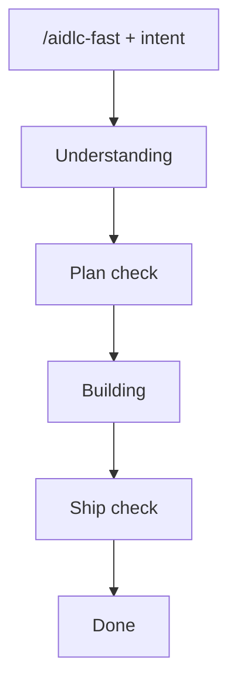

# aidlc-fast workflow

| Who | What |
|-----|------|
| Human | `/aidlc-fast`, checkbox replies |
| Agent | Runs CLI (`start` / `complete` / `rework` / `approve --human-reply`) |

Scopes: `bugfix` · `feature` · `refactor` · `mvp` · `security-patch` · `express`
